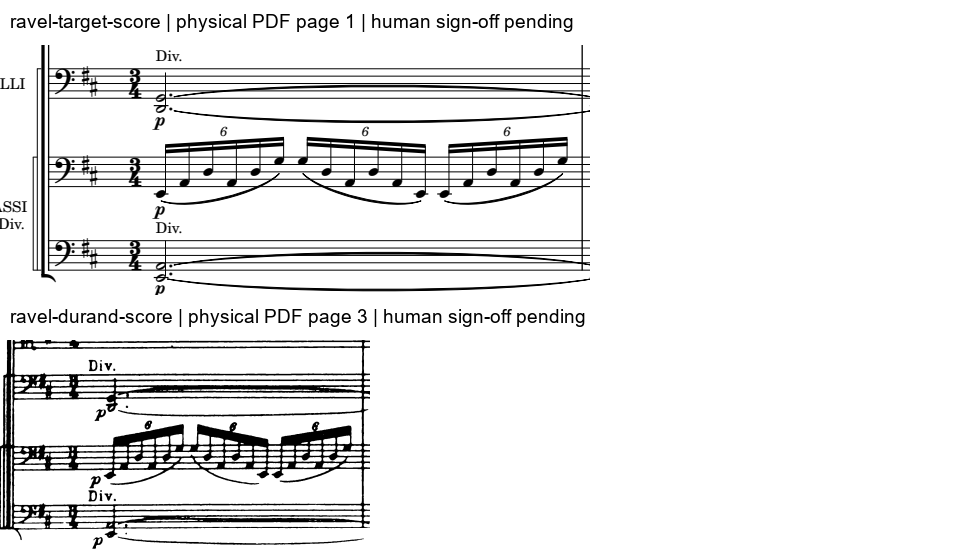
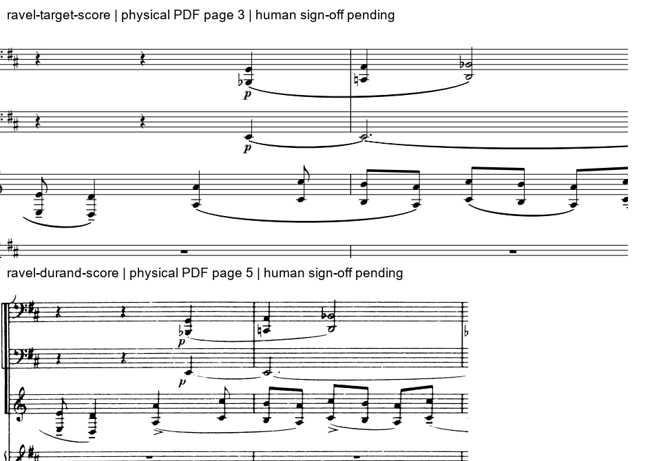
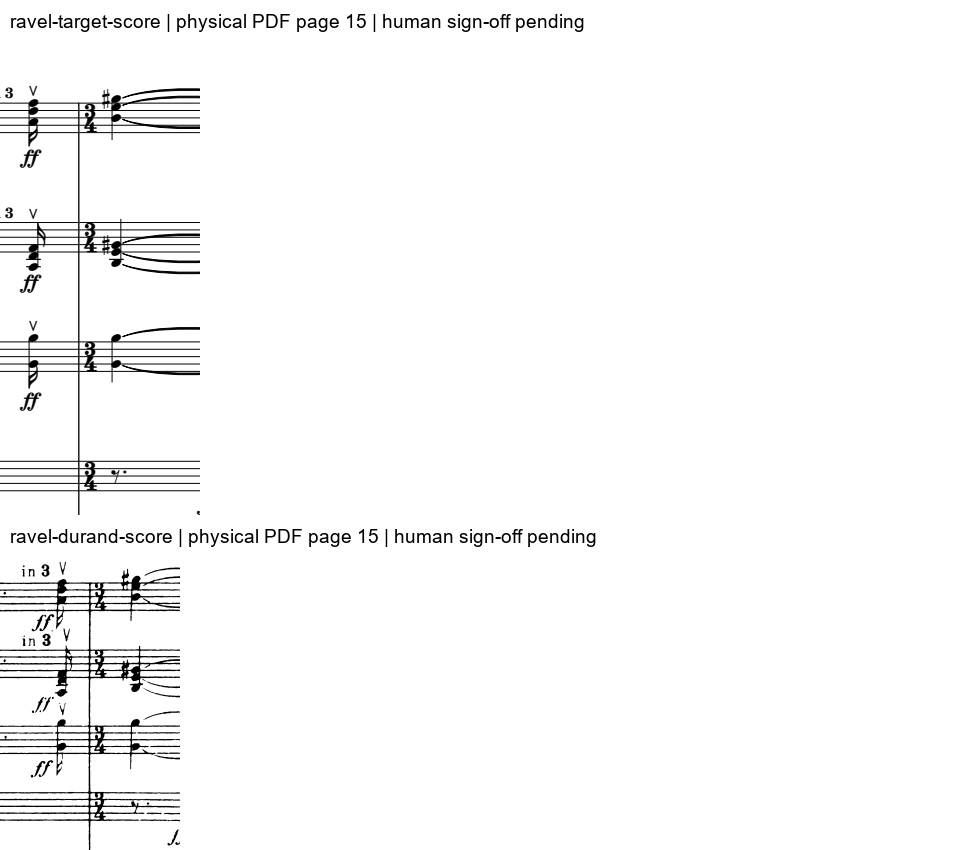

# 拉威尔：可供人工签核的局部符号底稿

杜兰扫描谱与导航重排谱对照。逐谱录入／图像核对由代理完成，人工签核待完成。时间为记谱四分音符单位，不是录音秒数。

# E–A–D–G：持续低音上的四度骨架

**谱面观察**
- 大提琴D2、G2持续；低音提琴持续层为实音E1、A1，活动层以六连音展开E、A、D、G。

**理论推导**
- 按E–A–D–G排列形成连续纯四度；集合缺B，不能写成完整E小三和弦或机械标D大调ii。
- 四度骨架由不同分部共同构成；分解层改变攻击密度，首小节音级集合并未因每次攻击而更换。

### 符号底稿：首小节：持续层与六连音分解层
只转录首小节的低弦分部；跨小节延音以延续标志记录，不把它截断为真实离键。
逐谱录入与图像核对：代理；人工签核：待完成。没有把代理读谱标为人类审核。

| 声部 | 记谱音 → 实音 | 起点／时值（四分音符单位） |
|---|---|---|
| 大提琴分部D2 | D2 → D2 | 0／3 |
| 大提琴分部G2 | G2 → G2 | 0／3 |
| 低音提琴持续E1 | E2 → E1 | 0／3 |
| 低音提琴持续A1 | A2 → A1 | 0／3 |
| 低音提琴六连音层 | E2 → E1 | 0／1/6 |
| 低音提琴六连音层 | A2 → A1 | 1/6／1/6 |
| 低音提琴六连音层 | D3 → D2 | 1/3／1/6 |
| 低音提琴六连音层 | A2 → A1 | 1/2／1/6 |
| 低音提琴六连音层 | D3 → D2 | 2/3／1/6 |
| 低音提琴六连音层 | G3 → G2 | 5/6／1/6 |
| 低音提琴六连音层 | G3 → G2 | 1／1/6 |
| 低音提琴六连音层 | D3 → D2 | 7/6／1/6 |
| 低音提琴六连音层 | A2 → A1 | 4/3／1/6 |
| 低音提琴六连音层 | D3 → D2 | 3/2／1/6 |
| 低音提琴六连音层 | A2 → A1 | 5/3／1/6 |
| 低音提琴六连音层 | E2 → E1 | 11/6／1/6 |
| 低音提琴六连音层 | E2 → E1 | 2／1/6 |
| 低音提琴六连音层 | A2 → A1 | 13/6／1/6 |
| 低音提琴六连音层 | D3 → D2 | 7/3／1/6 |
| 低音提琴六连音层 | A2 → A1 | 5/2／1/6 |
| 低音提琴六连音层 | D3 → D2 | 8/3／1/6 |
| 低音提琴六连音层 | G3 → G2 | 17/6／1/6 |

**音程见证（半音数，保留复音程）**
- cello-G ↔ cello-D：0：G2/D2=5；1/6：G2/D2=5；1/3：G2/D2=5；1/2：G2/D2=5；2/3：G2/D2=5；5/6：G2/D2=5；1：G2/D2=5；7/6：G2/D2=5；4/3：G2/D2=5；3/2：G2/D2=5；5/3：G2/D2=5；11/6：G2/D2=5；2：G2/D2=5；13/6：G2/D2=5；7/3：G2/D2=5；5/2：G2/D2=5；8/3：G2/D2=5；17/6：G2/D2=5

**边界与未决项**
- E是低音支点，不等于已确定三度和弦根音。

# 先合并加倍：圆号与巴松的异节奏进行

**谱面观察**
- 圆号两层始终相距八度；巴松双音由B♭1/G2、C2/A2、D2/B♭2构成平行六度层。

**理论推导**
- 先把圆号八度加倍与巴松平行六度分别视为层，再比较层间关系。圆号八分运动与巴松四分／二分时值形成独立节奏与斜向运动。
- 第二小节圆号实音F4–E4–D4下行，巴松B♭2保持：复音程为纯十二度→增十一度→大十度。弱八分的E4在这对声部中是经过性不协和。
- 低音巴松同时维持E1，故不能把这个局部经过音判断直接扩大为全织体的和弦外音。这里是分层的自由声部关系，不是卡农或赋格。

### 符号底稿：第10–11号：圆号、巴松与E持续音
谱面标号10、11两小节；圆号按F调乐器降纯五度转为实音，低音巴松降八度。末尾保持开放，不据两小节认定完整乐句终止。
逐谱录入与图像核对：代理；人工签核：待完成。没有把代理读谱标为人类审核。

| 声部 | 记谱音 → 实音 | 起点／时值（四分音符单位） |
|---|---|---|
| 圆号上层 | E4 → A3 | 0／1/2 |
| 圆号上层 | D4 → G3 | 1/2／1 |
| 圆号上层 | A4 → D4 | 3/2／1 |
| 圆号上层 | C5 → F4 | 5/2／1/2 |
| 圆号上层 | B4 → E4 | 3／1/2 |
| 圆号上层 | A4 → D4 | 7/2／1/2 |
| 圆号上层 | C5 → F4 | 4／1/2 |
| 圆号上层 | B4 → E4 | 9/2／1/2 |
| 圆号上层 | A4 → D4 | 5／1/2 |
| 圆号上层 | C5 → F4 | 11/2／1/2 |
| 圆号下层 | E3 → A2 | 0／1/2 |
| 圆号下层 | D3 → G2 | 1/2／1 |
| 圆号下层 | A3 → D3 | 3/2／1 |
| 圆号下层 | C4 → F3 | 5/2／1/2 |
| 圆号下层 | B3 → E3 | 3／1/2 |
| 圆号下层 | A3 → D3 | 7/2／1/2 |
| 圆号下层 | C4 → F3 | 4／1/2 |
| 圆号下层 | B3 → E3 | 9/2／1/2 |
| 圆号下层 | A3 → D3 | 5／1/2 |
| 圆号下层 | C4 → F3 | 11/2／1/2 |
| 巴松上层 | 休止 | 0／1 |
| 巴松上层 | 休止 | 1／1 |
| 巴松上层 | G2 → G2 | 2／1 |
| 巴松上层 | A2 → A2 | 3／1 |
| 巴松上层 | Bb2 → Bb2 | 4／2 |
| 巴松下层 | 休止 | 0／1 |
| 巴松下层 | 休止 | 1／1 |
| 巴松下层 | Bb1 → Bb1 | 2／1 |
| 巴松下层 | C2 → C2 | 3／1 |
| 巴松下层 | D2 → D2 | 4／2 |
| 低音巴松E持续音 | 休止 | 0／1 |
| 低音巴松E持续音 | 休止 | 1／1 |
| 低音巴松E持续音 | E2 → E1 | 2／4 |

**音程见证（半音数，保留复音程）**
- horn-upper ↔ horn-lower：0：A3/A2=12；1/2：G3/G2=12；1：G3/G2=12；3/2：D4/D3=12；2：D4/D3=12；5/2：F4/F3=12；3：E4/E3=12；7/2：D4/D3=12；4：F4/F3=12；9/2：E4/E3=12；5：D4/D3=12；11/2：F4/F3=12
- bassoon-upper ↔ bassoon-lower：2：G2/Bb1=9；5/2：G2/Bb1=9；3：A2/C2=9；7/2：A2/C2=9；4：Bb2/D2=8；9/2：Bb2/D2=8；5：Bb2/D2=8；11/2：Bb2/D2=8
- horn-upper ↔ bassoon-upper：2：D4/G2=19；5/2：F4/G2=22；3：E4/A2=19；7/2：D4/A2=17；4：F4/Bb2=19；9/2：E4/Bb2=18；5：D4/Bb2=16；11/2：F4/Bb2=19
- horn-upper ↔ contra-pedal：2：D4/E1=34；5/2：F4/E1=37；3：E4/E1=36；7/2：D4/E1=34；4：F4/E1=37；9/2：E4/E1=36；5：D4/E1=34；11/2：F4/E1=37

**边界与未决项**
- 局部严格音程检查不等于整段采用严格对位法；句末及完整调性功能不在该两小节内确证。

# 弦乐D/A → E/A：相邻攻击不呈终止四六解决

**谱面观察**
- 弱起中第二小提琴为A3–D4–F♯4，中提琴有低A3；下一攻击小提琴移至B3–E4–G♯4，A持续。

**理论推导**
- 所取攻击层第一切片为D大三和弦第二转位；在D语境中可标I6/4。
- 规范终止四六在A低音上通常涉及D→C♯、F♯→E；这里观察到D→E、F♯→G♯的上行，与该解决模式不符。
- 更合适的局部解释是上层三和弦平移与A持续层叠合；不能把第二切片仅凭E大三和弦就宣布为向A解决的V/V。

### 符号底稿：乐队重入：弦乐攻击层的D/A与E/A
只比较第二小提琴三音排列与中提琴低A；排除钢琴余响，不能当作全体实际音响。仅转录两个攻击切片，不推定第二个攻击的完整时值。
逐谱录入与图像核对：代理；人工签核：待完成。没有把代理读谱标为人类审核。

| 声部 | 记谱音 → 实音 | 起点／时值（四分音符单位） |
|---|---|---|
| 第二小提琴低层 | A3 → A3 | 印号63末十六分弱起（仅攻击切片） |
| 第二小提琴低层 | B3 → B3 | 印号64首个攻击（仅攻击切片） |
| 第二小提琴中层 | D4 → D4 | 印号63末十六分弱起（仅攻击切片） |
| 第二小提琴中层 | E4 → E4 | 印号64首个攻击（仅攻击切片） |
| 第二小提琴高层 | F#4 → F#4 | 印号63末十六分弱起（仅攻击切片） |
| 第二小提琴高层 | G#4 → G#4 | 印号64首个攻击（仅攻击切片） |
| 中提琴低A层 | A3 → A3 | 印号63末十六分弱起（仅攻击切片） |
| 中提琴低A层 | A3 → A3 | 印号64首个攻击（仅攻击切片） |

**相邻攻击的声部进行**
- vln2-low：A3 → B3，2半音
- vln2-middle：D4 → E4，2半音
- vln2-high：F#4 → G#4，2半音
- viola-pedal：A3 → A3，0半音

**边界与未决项**
- 仅针对选取的弦乐攻击层，不包含钢琴踏板余响；全体最低音、后续D到达和终止功能需另论。

## 理论判据的出处

规范终止四六的同声部6–5／4–3解决参照[Open Music Theory](https://viva.pressbooks.pub/openmusictheory/chapter/cadential-64/)。经过性级进的定义参照[Hutchinson，10.2 Passing Tones](https://musictheory.pugetsound.edu/mt21c/PassingTones.html)。这里用作判据，拉威尔的具体结论来自所列谱面窗口。
