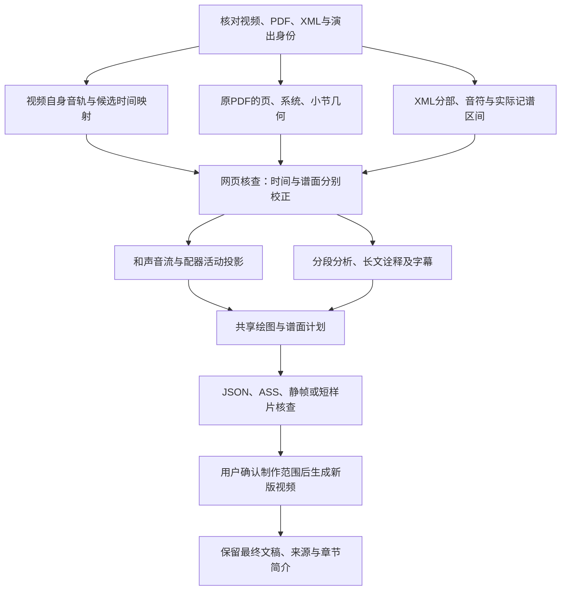

# Ariadne 新视频制作与旧版重制技术路线

本指南固化2026-10-27普罗科菲耶夫第二钢琴协奏曲制作中的方法，供新作品接入、同作品更换演出、旧视频重新排版时使用。用户明确的制作范围优先；只要求JSON、字幕或谱面计划时，做到相应阶段即可，不自动编码整部视频。

日常入口仍是根目录的`启动播放器.bat`与`编辑视频字幕.bat`。具体操作见[视频制作流程](video-production.md)，写作原则见[分析撰写流程](analysis-writing.md)，当前普二文件见[完整版指南](../guides/prokofiev2-full-video.md)。

## 1. 先判断这次需要重做什么

| 变化 | 可继续复用 | 需要重新准备或核查 |
|---|---|---|
| 同一视频，仅改文字、字号、位置、退场和滚动 | 原DTW、PDF几何、XML证据、媒体副本 | 当前字幕、ASS、布局及可见性计划 |
| 同一视频，改和声／配器面板颜色或大小 | 原记谱事件和录音投影 | 面板绘图计划、避让空间；已有自定义字幕坐标需复查 |
| 同一视频，调整诠释出现时段 | 同步和谱面几何 | PDF隐藏／恢复、栏目互斥及当前页计划 |
| 换演出或重新剪辑／变速 | 身份相容时的原谱、XML与作品研究 | 新媒体指纹、音乐范围、同源音轨对齐和全部录音投影 |
| 换PDF版本、裁切或重排 | 身份相容时的作品研究与符号材料 | PDF指纹、页／系统／小节几何及其对应；不复用旧矩形 |
| 换XML版本或修订音符时值 | 可核对保留的原始材料 | 符号证据、声部身份、局部时轴、PDF对应及音符投影 |
| 新作品 | 本指南的组织、接口和检查方法 | 独立作品目录、输入清单、作品适配与证据 |

源媒体、原谱、当前字幕、人工校正、已激活／冻结快照及续跑工程均保留。旧视频重制只更新当前需要更新的层，不重排原有音乐时间来迁就版面。

## 2. 整体流水线



各层独立保存依据。音符解析、PDF框、XML序号、印刷小节号、录音秒数和音乐解释分别核查；一个层通过检查，不替其他层签核。

## 3. 同源视频与统一时钟

每场演出建立独立`media-sync.json`与对齐结果，至少记录路径、SHA-256、字节数、时长、音视频轨道与音乐覆盖范围。阵容相同也不直接认定是同场、同剪辑；上传日期不能代替演出日期。

优先从当前视频提取分析音轨。以该视频为播放主时钟，按乐章或有证据的连续音乐范围对齐；片头、掌声、停顿与加演单独处理。原有chroma与DLNCO、MrMsDTW及人工锚点路线继续使用。

| 时间 | 含义 | 用途 |
|---|---|---|
| XML局部有理数时值 | 小节序列与小节内位置 | 记谱事件、延音线、声部关系 |
| 参考时间 | 辅助MIDI／参考时轴 | 桥接已建立的录音映射 |
| `videoTime` | 原演出视频秒数 | 网页播放、音符活动、PDF与字幕共同定位 |
| `outputTime` | 当前导出片段的秒数 | 编码及ASS；剪切时显式转换 |
| `musicTime` | 相对本曲音乐入口的显示时间 | 界面说明；不替换原视频时钟 |

覆盖范围外不外推音符、和声或高亮。辅助MIDI的速度不作为实际演奏速度，华彩与自由速度不均分。换演出时重建录音投影，作品文字与谱面可在核对身份后共享。

## 4. 和声音流与配器激活表盘

### 4.1 两个表盘各自回答什么

| 组件 | 展示内容 | 当前普二组织 |
|---|---|---|
| 和声音流 | 音符进入、持续、结束及12音级分布 | 钢琴、弦乐、木管、铜管、打击乐五类 |
| 配器激活 | 各分部何时发声、持续、休止 | 19个独立分部模块，按独奏与乐器家族排列 |
| 下方分析文字 | 和声关系、配器职责、声部组织、曲式解释 | 四类分析，另有导聆与长文诠释 |

“五类”是普二这套编制的显示配置，不是按人数或分部数量截成五个。配器面板保留实际分部，例如第一、第二小提琴分别显示；它们不是虚构的两个独奏者。

以后的小提琴协奏曲使用明确标记的独奏小提琴；交响曲不自动把第一小提琴标成独奏；弦乐四重奏可按四个实际分部组织。扩展入口是乐器注册表和`harmony_groups`／`flow_groups`，不靠在绘图代码里猜“钢琴一定存在”。

### 4.2 数据和音乐含义

- 记谱事件保留分部、谱表、声部、音符ID、实音音高、起止位置及延音线。移调只应用一次。
- 连续延音线合并成持续区间，不重新闪烁；同音的再次攻击仍是新的起音。
- 实际活动采用半开区间`[start,end)`，不把整小节的乐器活动并集称为每个时点的配器。
- 非定音打击乐使用独立节奏轨，不虚构C到B音级；有音高的定音鼓仍保留实音信息。
- 同音级加倍不通过叠加透明度冒充更响。记谱时值不等于踏板或真实声学余响。
- XML已知异常用未知状态和证据隔离表达，不把数据缺失显示成确定休止。

和声音流首先是客观记谱展示。当前既有和声方法继续使用，ChordGNN试验不成为默认识别器或制作前提。

### 4.3 颜色、动画与共用渲染

以字幕黄为中心，向橙、琥珀、黄绿和青绿拉开区别。普二五类基准色为钢琴`#FFDF42`、弦乐`#F27943`、木管`#77CBB1`、铜管`#F9AC43`、打击乐`#BBD579`；逐件配器模块另有分部颜色。颜色始终配合文字名称使用。

配器起音约0.16秒闪亮，持续时柔和高亮，结束约0.18秒回暗。动画由传入的媒体时间决定，暂停、跳转和倒序取帧均可重算，不靠墙上时钟累计状态。

共享入口：

| 文件 | 职责 |
|---|---|
| `review/harmonic-flow.mjs` | 音流状态、绘图命令与Canvas 2D适配 |
| `review/orchestration-activity.mjs` | 分部模块的确定性活动状态和绘图命令 |
| `review/interval-index.mjs` | 活动区间索引，避免每帧全量扫描 |
| `review/visual-export.mjs` | 两表盘的组合、位置与覆盖范围 |
| `backend/video_export/visual_raster.py` | 离线执行同一绘图命令 |
| `backend/video_export/visual_panels.py` | 乐器注册、颜色和大小配置 |

网页Canvas与离线Pillow共用状态和绘图几何，字体栅格化可能不同。Canvas适配存在不等于每首曲目已在真实网页挂载／验收；网页接入和实播另行确认。

统一批处理可调整两个面板各自60%–150%的整体大小。默认400×240的音流与约520×280的配器面板以1920×1080为基准；编制变化会影响模块行数。尺寸改变后，复查自定义文字位置、字号和可读性。

## 5. PDF高亮定位：先几何，后对应，再时间

### 5.1 识别与编号分开

先确认PDF版本、指纹、物理页数、每页尺寸、旋转以及乐章页范围。物理页、印刷页、XML小节序列、印刷小节号、排练号分别保存。

识别到方框数字不直接当小节号；检测到多少个框，也不直接填成已核验的印刷小节号。优先使用稳定区域ID与源序列作为连接，未知的`printed_measure_number`保留空值。

### 5.2 原PDF几何

| 原谱类型 | 几何路线 | 必须检查 |
|---|---|---|
| 矢量PDF | 读取实际线段、文字和谱表关系 | 坐标原点、旋转、小节线与符干的区别 |
| 扫描PDF | 从图像检测五线谱、系统和跨谱表支持的小节线 | 连谱线、双小节线、装饰线、漏检、弯斜、特殊华彩 |

对扫描谱先做开头、中段、结尾及华彩样本。多个谱表共同支持的长竖线比单谱表竖线更有定位价值；谱号、调号列和符干也可能产生假边界。检测像素需按实际渲染比例换算为PDF点，不能把像素数原样写入`rect_pt`。

最终统一为PDF点、左上原点的`rect_pt=[x,y,width,height]`，保存页面宽高、物理页、系统索引、识别方法、源指纹和复核状态。几何检测不承担音高或和声认定。

### 5.3 XML与PDF的对应

按实际页面、系统、可见小节组织核对XML布局与原谱。数量吻合只是对应候选，需要主题、休止、拍号、排练号或实际谱例继续支持。原XML重排页与另一版总谱不能直接同号。

遇到数量差异先停在当前页／系统，检查漏检、连线、双线、跨系统延续或XML异常，不让一次误差传递到后面所有页。谱面修正保存旧值与理由，不覆盖原检测证据。

当前普二的可回查案例：

- 原谱168物理页、294个系统，864个XML参考区间，855个精细框；这些数字有不同含义。
- 物理140页第0系统承接终章193–201小节的九个XML区间，共享实际谱面区域。保持真实共用区域并抑制播放线，不按等宽假造九个“已可靠识别”的小节框。
- 物理153页的XML序列811、812为无常规小节线的延续区域，保留区域定位并关闭误导性的横向播放线。
- 当前框仍是候选几何与对应，代理核查不代填人类签核。

### 5.4 时间绑定与校正

经核对的XML／参考区间通过原有DTW映射到当前视频秒数，再连接到PDF区域。乐章之间、片头、掌声和加演停用高亮及播放线。

三类人工修正保持独立：

| 文件 | 修正对象 |
|---|---|
| `review-anchors.json` | 参考时间到当前录音时间的映射 |
| `score-region-anchors.json` | 某PDF区域的录音起止时间 |
| `score-measure-corrections.json` | 自动计数候选与真实编号的对应 |

编号正确不能证明时间正确，时间准确也不能修复错框。无足够证据时降低到系统级／页级显示或暂不画线。

### 5.5 网页与离线视频采用同一坐标变换

离线复用`review/video-export.mjs`，继续调用`playhead.mjs`、`score-follow.mjs`及`score-display.mjs`。PDF页面、高亮与播放线经过相同的缩放、纸张偏移和滚动变换。

设源矩形为`(x,y,w,h)`，缩放为`s`，纸张在显示区内偏移为`(px,py)`，滚动为`(left,top)`，显示区左上角为`(vx,vy)`：

```text
屏幕x = vx + px + s*x - left
屏幕y = vy + py + s*y - top
屏幕宽 = s*w
屏幕高 = s*h
```

“乐谱贴右”须同时处理显示区位置与纸张内部对齐。当页面按高度适配、宽度小于显示区时，只把容器挪到右边仍会留下空隙。高亮和播放线随同一变换移动。

诠释隐藏PDF时，内部播放时钟继续推进；恢复时显示当前页，不恢复隐藏前那一页。跳转、倒序取帧和放大后结果仍须确定，避免滚动状态累积。

### 5.6 关键文件与适配边界

原数据在各作品独立目录：`media-sync.json`、`alignment.json`、`measure-map.json`、可选`score-measures.json`、几何原始结果及复核记录。公开资料使用仓库相对路径；源媒体仍只留本机。

普二的`prokofiev2_sync.py`、`build_prokofiev2_playback.py`、`build_prokofiev2_live.py`包含当前XML、扫描谱和乐章范围的专用适配，并绑定已冻结输入。它们是案例入口，不能仅改曲名套到新作品，也不要为重排字幕重新运行它们。马四与拉威尔的旧适配器同样有版次边界。

## 6. 新布局：动态图、短分析和长文分工

视频全屏作为底层；上方放和声与配器表盘，右侧放原谱，左侧／中下部放四类短分析及导聆。文字为黄色楷体，不额外添加实体分析卡片背景。表盘使用克制的深色半透明底。

下表为当前普二100%表盘大小、1920×1080导出的默认值，实际定义在`backend/video_export/visual_full.py`。新分辨率或新编制应建立相应profile，不把这组像素值宣称为任意画布通用布局。

| 内容 | x / y | 宽 / 高 | 字号 |
|---|---|---|---:|
| 和声短分析 | 40 / 320 | 600 / 168 | 32 |
| 配器短分析 | 664 / 320 | 600 / 168 | 32 |
| 声部关系与复调 | 40 / 496 | 600 / 168 | 32 |
| 曲式与主题发展 | 664 / 496 | 600 / 168 | 32 |
| 导聆 | 40 / 672 | 1224 / 168 | 30 |
| PDF显示区 | 1320 / 320 | 600 / 736 | — |
| 长文诠释 | 220 / 336 | 1480 / 720 | 44 |

四类分析列间24像素，行间8像素。短文按实际内容使用空间，避免为了占满画面而机械拉大区块。面板默认尺寸变化会调整默认避让，字幕JSON中已保存的栏目／单条坐标仍有更高优先级，须人工复查这些自定义值。

长文诠释出现时暂隐四类短分析、导聆与PDF，保留上方两表盘；结束后恢复当前谱页。原作品可继续使用自己的隐藏规则，不能把普二的新配置机械覆盖所有旧项目。

## 7. 滚动、完整末段与长文诠释

### 7.1 普通分析的滚动终点

短文能放下就静止。长文只移动真实溢出的距离：

```text
溢出行数 = max(总行数 - 完整可见行数, 0)
移动距离 = 溢出行数 × 固定行距
移动时间 = 移动距离 ÷ (每秒像素速度 × 滚动倍速)
```

最后一行完整进入后停止，保留完整末段供阅读，之后整体退场。不能因为字幕总时长还没结束而继续向上推空。停止状态只保留完整尾行，避免上边缘残留半行字。

正文高度扣除固定标题、上下留白后再计算完整可见行数。细小的末行与上一行重新平衡，优先保留拉丁单词完整换行，避免独剩“角。”一类尾巴。当前普通正文像素速度26、行距约1.12倍字号；这些是可调制作参数。

### 7.2 读完自动退场

当前普二短文的可见时长为：

```text
min(音乐源范围的剩余时间,
    max(10秒, 非空白字符数 / 每秒5字 + 3秒读后停留))
```

淡入约450毫秒、淡出约1600毫秒，包含在显示时段内。原稿的大段起止仍保留，用实际显示时长核对栏目重叠。相邻相同文字不重新启动阅读计时。

已过阅读期的旧分析不在诠释结束后补播。华彩长段落中的信息更新依靠后续有依据的文案，不靠同一句话常驻。

### 7.3 长文的缓升与渐隐

诠释恢复为完整论述，当前通常约半分钟到五十秒。正文各行在宽幅平面矩形内一起缓慢上移，并在末约4秒整体渐隐；保持矩形，无透视倾斜。

移动距离有明确上限，所有行在渐隐前仍应完整留在框内。上移与普通正文的溢出滚动使用不同模式；不能把长文最后几行滚空。当前基准上移100像素乘0.75倍速，约75像素。

说明一个音乐过程即可形成长文，不凭空指定本场踏板、触键或微观速度。文献的演奏比较要保留作者和版本边界；Horobets是论文作者，不是王羽佳本人，论文提及的年份／上传不能直接当作本地演出日期。

## 8. 分析分布：音乐结构约束下的均衡

### 8.1 统计实际文字空白

将四类分析、导聆、诠释等最终可见区间合并，再求音乐覆盖范围内的补集。自动退场、互斥隐藏和淡出计入最终显示，不能只按JSON中原始大段的结束时间统计。乐谱和表盘不算分析文字，乐章间停顿另列。

### 8.2 补写的硬约束和软目标

| 类型 | 规则 |
|---|---|
| 音乐范围 | 用已有乐句、材料交接、配器、动态或织体事件确定候选入口与正文有效范围 |
| 时间身份 | 原视频、对齐、原谱／XML指纹一致，不从空白中点生成音乐边界 |
| 阅读预算 | 按实际字符量与显示模式留足阅读及渐隐时间，过短时缩写或换位置 |
| 聆听空间 | 本次实例在原空白起点后至少留5秒，各次新增阅读之间至少留5秒 |
| 结尾与停顿 | 保留乐章停顿、末音和必要的弱化；正文不越过自己的音乐范围 |
| 均衡目标 | 以覆盖率和最长连续空白检查密度；本次每段音乐约40%–70%为软目标，不是普适标准 |

长空白可以采用“一段长诠释＋一次局部短分析”；中等空白选择一到两次具体分析；结尾只在尚有足够音乐范围时补提示，再退场。短分析错开栏目进入，围绕相关的一两维展开。

当前方法由人工／代理先提供有来源的文案和语义范围，程序按这些约束安排阅读时长并检查覆盖。`backend/video_export/coverage.py`和`presentation.py`是可复用部件，不能据此声称系统已经自动识别所有主题与结构。

### 8.3 普二实例与后续迭代

首轮只为讨论过的十段补写18条：3长、15短，原200条逐项保留，总数218。原十段内最长音乐空白从98.55秒降到18.97秒，各段音乐内文字覆盖约41%–65%；全曲文字空白59.11%降为41.98%，其他未处理区间仍可能较长。

输入为`gap-fill-plan.json`：原文稿指纹、目标空白、语义入口、范围、来源与完整文案；输出`gap-fill-evidence.json`：实际秒数、阅读量、来源指纹、前后覆盖和保留证明。下一轮基于用户当前文稿重新统计，再决定处理范围，不重复覆盖上一轮之后的用户修改。

详见[十段补写报告](../../reports/prokofiev2-gap-fill-20261027.md)。

## 9. 唯一编辑入口与参数归属

| 内容 | 当前入口 |
|---|---|
| 作品／包／文稿成对注册 | `config/video-export.json`的`editor_projects` |
| 文字、时间、标题、可见性 | 当前项目`captions-editable.json`或既有项目文稿 |
| 字号、栏目与单条位置／字体／倍速 | JSON的`字号`、`字幕样式`与单条`样式` |
| 自动退场、淡出、长文模式与互斥 | JSON的`呈现规则` |
| 表盘大小和颜色 | 唯一批处理中的面板设置；本机偏好在`local/video-export/` |
| 可分享的最终字幕快照 | `config/published-caption-snapshots.json`列出源编辑稿与发布副本 |

不增加另一套字幕编辑器。普通修改在原文稿上进行，不重新导入网页研究或重跑分析。每次另存`edits-XXX`，保留旧成片；旧窗口可能覆盖新JSON，外部修改后重新打开编辑器。

拉威尔完整版当前编辑稿继续保留在本机导出包中，另将同内容发布为`works/ravel-left-hand-video/video-export/captions-final.json`。新机器先建立相应本机资源包，再导入发布副本；已有用户文稿时不自动覆盖。复制发布快照不移动原文件，也不改变当前批处理读取位置。

普二可直接打开：

```powershell
.\编辑视频字幕.bat --project prokofiev2-full
```

“保存修改”只存JSON；“仅导出ASS”不编码。完整生成由用户明确选择。旧版重制保留原章节和媒体时钟，并从当前字幕重新计算PDF互斥与恢复。

## 10. 输出时钟、编码与体积控制

源视频标称30fps不保证每个时间戳间隔都严格等于1/30。读取整数PTS与实际time base，避免把日志里四舍五入的长时间秒数当精确帧时间。动态图形按原视频帧时间取值，主画面保持原呈现时间；辅助层的匹配不强行重置主视频时钟。

当前完整普二导出使用原AAC音轨复制，在兼容容器条件下避免音轨重编码；不在输出端用固定`-r`强制改帧率。样片曾单独转码AAC，不能把样片音轨处理说明直接套到完整导出。

完整导出采用流式逐帧绘图，带背压传给编码器，不保存整部电影的庞大逐帧JSONL。45秒样片历史中间帧文件可以再生成；清理前核对它不是当前运行输入或校验清单中的必需文件。

## 11. 新作品和旧版重制的执行顺序

1. 记录本次范围：仅网页、仅JSON／ASS、短样片，或完整视频。保存当前文稿和人工校正。
2. 用第1节判断哪些层失效。新演出先重建录音时间；新PDF先重建几何；单纯排版沿用旧同步。
3. 小范围核对首尾、华彩、休止与跨页，建立可追溯的区域和时间证据。
4. 在网页检查章节跳转、候选高亮、乐器活动与分析范围，再准备离线资源。
5. 按真实编制注册分部与和声分组，测试延音线、打击乐、未知区间、暂停和跳转。
6. 从完整研究正文写短分析与长诠释，保留文献归属、实际阅读范围和音乐有效范围。
7. 设置表盘、PDF、四类短文和长文的版式；核对最大字号、三行以上正文及长文末段。
8. 统计实际空白与密度，按音乐事件补写，经阅读预算及互斥检查后更新JSON。
9. 先输出字幕／谱面计划；需要视觉核查时生成少量静帧或经授权的短样片。用户未要求整片时在此停止。
10. 按授权生成新成片，检查首尾、华彩、诠释切换、乐章停顿、当前页恢复及章节。
11. 保存最终字幕、来源台账和简介。简介章节从实际导出时轴生成，阵容与日期按证据填写。
12. 清理可确认的测试缓存，提交代码、文稿、谱面与预计算数据。视频、导出包、工具、环境与续跑工程留本机。

## 12. 验证范围与发布

| 检查 | 证明的范围 |
|---|---|
| 结构／单元测试 | 区间、转置、延音、边界、布局、文本阅读预算和兼容行为 |
| 实际HTTP模块图＋模拟DOM／媒体 | 资源可载入、接口连接、跳转及状态更新；不证明真实视频解码 |
| 谱页图像检查 | 选定区域、谱面对应与所写具体判断；不扩张为全曲逐音校勘 |
| 少量真实合成静帧／样片 | 实际字体、遮挡、透明度、滚动与谱面合成 |
| 用户实播／试听 | 实际呈现和音乐同步反馈，范围按实际核查记录 |

关键情形包括：最短与最长文本、停止后完整末行、单字尾行、拉丁词换行、最大表盘、乐谱右贴、共享华彩、无小节线延续、诠释前后、倒序跳转、三个乐章停顿、片头和末尾。

播放只需最小Python依赖，处理／导出依赖另装；Node用于可选检查和离线共用JS，播放器本身不需要Node。运行全部处理测试应使用已有处理环境，不把缺少可选音频／MIDI库误报为播放功能失败。

发布前检查实际Git索引：

```powershell
python scripts/check_publish.py
git diff --cached --check
git diff --cached --stat
```

所有视频均不上传。当前文稿、原始材料、已激活证据、历史OMR和人工校正不作为“中间产物”删除。测试源代码保留，运行生成的测试副本和可再生成帧数据先核对范围；不确定的工作文件保留或完整归档。GitHub不包含本机导出包，发布快照不意味着另一台机器已经有同版视频和完整编码缓存。

## 13. 本轮相关记录

- [普二同步、扫描谱与高亮](../../reports/prokofiev2-sync-20261027.md)
- [实时记谱活动、首个音流样片与字幕整行停留](../../reports/prokofiev2-live-flow-and-caption-rest-20261027.md)
- [五类和声与逐件配器面板](../../reports/orchestration-visual-panels-20261027.md)
- [完整资源包与字幕准备](../../reports/prokofiev2-full-package-20261027.md)
- [滚动终点、紧凑布局、贴右谱面与长文](../../reports/prokofiev2-presentation-20261027.md)
- [十段空白的接续分析](../../reports/prokofiev2-gap-fill-20261027.md)

这些记录分别保留当时的文件与验证状态，历史截图不替代后来版式的验收。用户反馈、代理检查、人类签核与专家审定分别保存。
