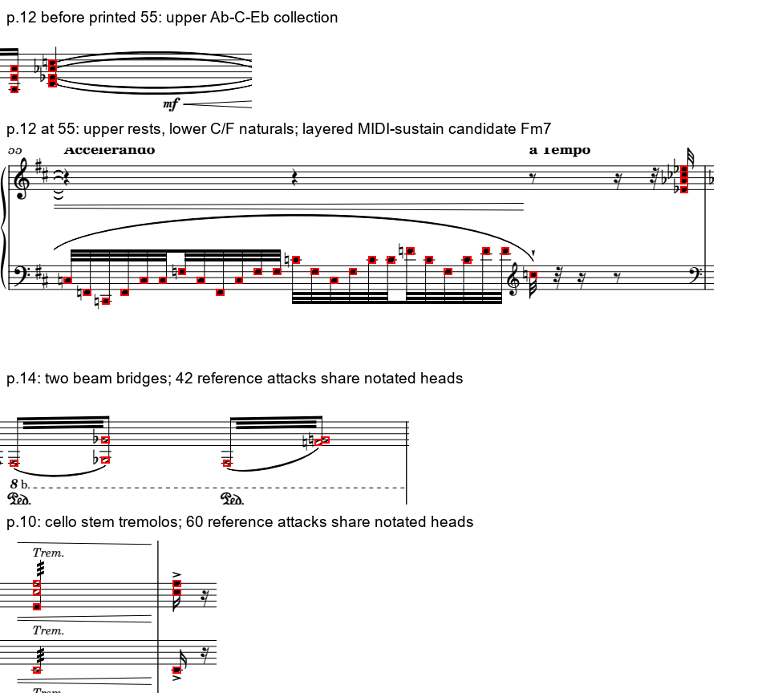

# 拉威尔A/B：记谱核查与技术判断第二轮

日期：2026-10-25。当前冻结稿为 `round1-a7657439303a57e6`。本轮继续处理物理1–3、10–15页；未扩展C/D，也未声称A/B已经达到完整音乐内容验收。

## 相对上一轮的变化

| 指标 | 上一轮9bf0f07362a89fb9 | 本轮a7657439303a57e6 |
|---|---:|---:|
| 无PDF对应的MIDI记录 | 406 | 217 |
| 其中有固定音高的记录 | 290 | 101 |
| 其中非固定音高打击乐记录 | 116 | 116 |
| 有关联但八度不一致 | 59 | 8 |
| 未匹配PDF音头 | 308 | 214 |
| 全部音高具有八度一致候选对应的和声窗口 | 923 | 1,526 |

这些是数据诊断数量，不是准确率。震音展开可让多个MIDI攻击共用一个实际音头，不能把新增对应等同于新增逐音校对。时值、踏板、录音时间和声部身份仍分别待核。

当前HUD：和声1,722、对位区间51、配器493、曲式区间19，均为候选。和声中间窗口仍为1,728；其中6个没有谱面关联的窗口不显示为当前技术事件。

## 实际修正

1. **降八度归属。** 第10页钢琴的8 bassa位于相邻小提琴附近，旧算法按距离误归属。现在结合明确的bassa后缀及谱表方向判断，允许音头与标记起点的小偏差；无延长线的标记只作用于相邻音组，不扩展到整行。首次独奏的A0、A1获得对应。
2. **临时记号持续。** 旧代码把穿过五线谱的长符干当作小节线，导致C、F的还原号过早失效；还把过近的首音临时记号混入调号。现在使用该版本的线宽与真实边界，保留小节内临时记号。
3. **延续音状态。** 已有正确延续音关联的记录，不再标成完全无定位；另注明起音尚未定位，不冒称已经找到新的攻击。
4. **震音几何。** 识别跨符干的多道原生斜线，以及白音头间的多梁连接。第10页大提琴60次重复攻击、第14页钢琴42次交替攻击获得实际记谱依据；没有为展开攻击画虚构音头。
5. **力度候选。** 排除实心填充梁形／曲线后，发夹形状候选从49个减为13个。这只是候选筛选，尚未把所有力度变化逐项验收。

单音／和弦震音与双音震音的符号关系参照[SMuFL震音规范](https://smufl.formats.music/latest/tables/tremolos.html)，八度标记参照[八度规范](https://smufl.formats.music/latest/tables/octaves.html)。具体谱面与MIDI对应仍由本地证据检查，不从符号名称直接推断演奏效果。

## 具体音乐判断

**第12页印号55：F/C低层与前段上层音组。** 低层C、F带还原号，延续使用还原音。前接上层集合为A♭–C–E♭；在辅助延音模型中，与F/C低层合成Fm7。上谱表此时可见休止，因此必须区分前段余响、MIDI延长键值与谱面持续按键。Fm7是分层归约候选，不是“源谱此刻所有声部仍同时按键”的结论，也不凭此宣布转入F小调。

**圆号入口：先辨加倍。** B♭2、B♭3的同时入口先支持八度加倍判断；两个谱表或轨道不足以证明独立对位。低弦背景、低音巴松与圆号的职责须分别观察。

**震音的配器意义。** 弦乐重复攻击属于记谱持续织体的实现候选，不能按每个短离键都重新宣布乐器退出。新增61处有原生震音依据的短缝隙记录；在本素材上，其他音仍维持同乐器活动，乐器级边缘数量没有因此减少。原MIDI活动边缘600条另存，支持记谱持续性的候选边缘也是600条；HUD的493条是其中具备谱面关联的展示事件，三者不能混算。

**Strepitoso：保留源谱／参考分歧。** 重排谱8 bassa解码的低音音区与辅助MIDI入口相差一个八度。另对照杜兰扫描谱物理14页的相同八度记号，但没有据缩略图宣布全部绝对音高已核清。旧“原位V7”的表述收窄为跨时归约，核查状态改为争议；旧事件及旧段落保存于 `analysis/revisions/cadenza-bass-dispute-20261025.json`。原MIDI及同步不改写。

**曲式与材料。** 五音轮廓对应、速度词、低音变化及乐队重入继续作为多类证据；不把一次Accelerando、Vivo或旧材料出现自动判成新分部或再现部。完整乐句、终止与全曲模型仍未定。

## 记录与界面

新增8组代理读谱记录，覆盖四个维度，保存在 `analysis/engine/reviews/`；`current.json`绑定当前轮次清单及记录指纹。点击相关HUD事件可以看到“谱面观察／理论判断／仍待核查”，并明确注明是代理抽查，未升级为人工或专家验收。

图像复核修正了初稿中两个过宽表述：上谱表休止不能由MIDI长键值覆盖；大提琴Trem.在图像可见，但文字抽取没有稳定归属。初稿与v2均保留，当前指针选择v2。

这是原PDF证据图，不是浏览器实播截图。早期独立快照、上一轮文献比较均保留；上一轮比较绑定9bf稿，不能把本轮新Fm7判断说成已得到论文验证。

## 剩余问题

101条有固定音高但无对应的参考记录包括：钢琴62、定音鼓31、第一小提琴3、第二小提琴2、长笛／A调单簧管／小号各1。钢琴部分含滑奏展开与复杂配对；不能只按音级把它们强行塞入一个图框。8条八度分歧也可能包含配对错误，尚不能把它们全部判成源谱错误。

214个未匹配音头包含延续、重复记谱及对应缺口；未做完整节奏、连线、踏板和真实声部转录。人工核查、专家审核计数仍为0。A/B门槛未解除，C/D保持关闭。

## 软件验证

- Python共121项：119通过、2项早期M4A实验跳过；本轮不扩展M4A。
- 前端28项通过，包括代理读谱状态与证据展示。
- 实际模块＋8766 HTTP内存DOM联调通过；新增检查印号55的读谱记录、Fm7归约和上谱表休止提示。它不是浏览器实播。
- 8765最小播放环境实际返回新记录与原始证据。同步、媒体、元数据与原有锚点保留。
- 浏览器控制上轮被设置禁用，本轮未修改设置，未补做真实浏览器、试听或专家验收。

机器记录见 `analysis/engine/reports/ab-notation-review-20261025.json`。本轮仍为工作区变更，尚未提交或推送GitHub。
