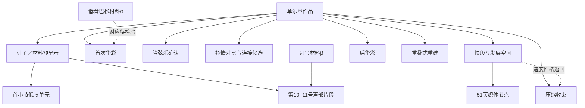

# 拉威尔：从谱面窗口到音乐理论判断

2026-10-26。研究主线改为直接读谱、局部符号底稿和可修订的论证。全曲MIDI—PDF匹配清零不再是前提。本轮没有重算对齐或修改旧匹配结果。

## 一、已经得到的音乐结论

### 1. 开头：四度骨架由不同分部共同构成

杜兰扫描谱物理3页与导航谱物理1页对照：大提琴分部持续D2、G2；低音提琴另一分部持续实音E1、A1；活动分部以三个六连音组展开E、A、D、G。十八个音合计三个四分音符，构成3/4的首小节。

持续层与活动层并未在每个音头上更换和弦。将音级按E–A–D–G排列，三个相邻关系均为纯四度。集合缺少B，不能直接写成完整E小三和弦或机械标为D大调ii；E首先是持续支点，未被证明是三度和弦的根音。

配器的作用也因此具体化：大提琴维持中低区持续层，低音提琴同时承担深低音和内部运动。后来低音巴松进入时，旋律前景与这些背景层的职责不同，不能因音区相近就合并为同一声部。

### 2. 圆号与巴松：先合并加倍，再分析真正的层间关系

杜兰物理5页与导航物理3页对照，录入谱面第10–11号两小节。F调圆号先转为实音；两个圆号层始终相距八度。巴松双音依次为B♭1/G2、C2/A2、D2/B♭2，分别构成大六度、大六度、小六度。

因此先把圆号八度加倍和巴松平行六度分别视为层，再比较层间节奏。圆号在第二小节以八分音符运动，巴松保持较长音，形成异节奏与斜向关系。

最有解释力的局部是圆号实音F4–E4–D4与保持的巴松B♭2：

| 圆号 | 与B♭2的半音距离 | 复音程 |
|---|---:|---|
| F4 | 19 | 纯十二度 |
| E4 | 18 | 增十一度 |
| D4 | 16 | 大十度 |

E4位于弱八分位置，并由F4级进到达、再级进至D4；在所选声部对中，它形成经过性不协和。不过低音巴松此时持续E1，E4与它相距三个八度。**局部声部中的经过性质，不能直接扩大为全织体的和弦外音判断。** 这比把四个谱表笼统称为“四条严格对位旋律”更符合实际分层。

本窗口支持自由声部关系的精细分析，不支持卡农或赋格判断。乐句片段仍保持开放，未强行认定完整前后句。

### 3. 重入的D/A：转位形态与终止功能分别判断

杜兰物理15页与导航物理15页对照，只取第二小提琴三音排列和中提琴低A的两个相邻攻击：

| 所取层 | 弱起攻击 | 次小节首攻击 |
|---|---|---|
| 第二小提琴低层 | A3 | B3 |
| 中层 | D4 | E4 |
| 高层 | F♯4 | G♯4 |
| 中提琴低层 | A3 | A3 |

第一切片为D/A，在D语境中具有I6/4形态。规范终止四六在A低音上通常要求D→C♯、F♯→E的同声部解决；这里实际观察到D→E、F♯→G♯上行。因此，**这两个直接相邻攻击不构成规范的6–5／4–3解决**。

当前更合适的局部读法是上层三和弦平移与A持续音叠合。第二切片不能只凭E大三和弦就直接宣布向A调解决的V/V。这个判断限定于选取的弦乐攻击层，排除钢琴余响，也不排除更长跨度中可能具有的其他功能。

规范终止四六的判据参照[Open Music Theory相应章节](https://viva.pressbooks.pub/openmusictheory/chapter/cadential-64/)，经过性级进的定义参照[Hutchinson，第10.2节](https://musictheory.pugetsound.edu/mt21c/PassingTones.html)。这些是一般理论判据；上述拉威尔结论由本地谱例推出。

## 二、配器直接研究

第51页所查两个系统有三种攻击／衰减层：长笛、短笛与竖琴的短音；钢琴连续十六分运动；小提琴、中提琴的拨弦支点。大提琴、低音提琴在这些系统休止。这里的透明度有明确的配置依据：持续低音重量减轻，短音前景与连续运动分离。竖琴的八度标记保留为谱面事实；尚未逐音录入的最高最低音不填写虚构数值，也不把图像配置当作已测得的听觉融合。

第95页末系统，钢琴仍在演奏复合层，中提琴、大提琴分部及低音提琴先以p长音进入，低音单簧管稍后弱起；其他多组木管、圆号和小提琴仍有休止。形式边界由独奏与乐队的重叠展开，不是在翻页处或一个全体齐奏攻击上截断。这些观察不依赖全曲MIDI音符覆盖。

## 三、曲式工作模型

建立作品—段落—乐句片段的层级，主题／材料身份单独登记，以便同一材料跨段关联。当前是可修订工作模型，不是已证明的标准奏鸣或三部曲式。

| 导航范围 | 工作功能 | 主要修订证据 |
|---|---|---|
| 1–10页独奏前 | 管弦乐引子、材料预呈示 | 低音巴松／圆号材料及配器扩展 |
| 10–15页 | 首次独奏华彩、呈示性空间 | 低音支点、旋律持续音、密度与结束姿态 |
| 15–24页 | 管弦乐主题确认 | 攻击层、低音到达、材料与配器 |
| 24–33页 | 抒情对比与连接候选 | Più lento、Andante、歌唱层与伴奏关系、终止 |
| 33–91页 | 快段与发展空间 | 6/8、Allegro；内部材料、调性和织体节点 |
| 91–95页 | 后华彩、回忆与重组候选 | 主题音程／节奏比较、局部句法 |
| 95–100页 | 重叠式管弦乐重建 | 低弦、低音木管与钢琴的入口先后 |
| 100页 | 压缩收束 | Allegro返回与结尾D中心；完整终止进行另核 |

页范围用于导航，重叠页承载交接，不是假定的精确形式切点。第51页是内部织体节点，没有因换配器就被自动设为独立分部。材料α、β、歌唱材料、快段材料与后华彩旋律均记录身份状态；未验证的跨段对应仍为候选。

每个单元有终止状态和修订说明。未完成的终止、完整句界及主题身份不通过速度词自动填定，也不把每一个五音模式都算作完整乐句。

## 四、持续研究工作流

1. 选择一个具有明确问题的小窗口，记录原谱物理页、区域及版本。
2. 直接录入需要的声部、记谱音、实音、时值、连线及移调。窗口之外不强行补全。
3. 由符号底稿计算音集、复音程与声部进行，再写理论结论及其适用范围。
4. 人工签核与代理读谱分开；出现异议时另存修订，不把旧稿覆盖成“早已正确”。
5. 配器直接查谱，曲式用材料、句法、终止、调性和配置共同修订。全局未匹配量不控制这些工作的准入。

两份完整节拍窗口和一份攻击切片底稿见[符号底稿与两版谱图](../analysis/score-studies/symbolic-windows-20261026.md)。它们由代理逐谱录入、作图像对照，**人工签核仍待完成**；没有宣称已获人类或专家审核。

播放器默认展示这些谱面研究及原有研究。自动候选改为勾选“显示自动候选（辅助）”后探索；勾选和HUD更新不重置右侧文章。逐谱研究接口 `/api/score-studies` 不依赖自动引擎，自动引擎损坏也不阻塞这条研究路线。

## 五、诊断保留为附录

冻结候选不改动。217条无定位MIDI记录、8条八度争议和214个未匹配PDF音头共439条诊断，按打击乐、震音、八度、移调、节奏、踏板、真实错误和未分类整理。移调、节奏、踏板桶中的内容是诊断假设，不能直接当作原因已证实。

当前诊断没有确认新的源材料错误；两项过去已修复的实现缺陷另列，不混入“总谱有错”。震音桶为空只说明当前未匹配集合中未出现有足够直接依据的该类记录，不说明作品没有震音。分类工具不会补匹配、改谱、改MIDI或自动修正。

完整分类：`analysis/score-studies/ravel-diagnostic-classification-20261026.json`。

## 六、验证与边界

本轮验证音符转调、时值填满、六连音、平行六度、八度加倍、局部经过性不协和、非规范终止四六解决，以及研究在自动引擎失效时仍能读取。源指纹、谱图和层级引用均检查。软件测试不能替代人工签核或专家审核。

Conda计算环境运行131项Python测试，129项通过、2项跳过；前端30项通过。最终底稿另跑10项专项测试通过，8765主服务的研究接口和三张绑定谱图均返回成功。实际模块与HTTP联调采用内存DOM。详见[机器验证记录](../analysis/score-studies/validation-20261026.json)，其中分别记录符号验证、接口检查、保留输入和未完成的人工环节。

真实浏览器检查再次被Work设置关闭的本地浏览器控制阻止；没有更改设置绕过。实际模块与HTTP的内存DOM检查不称为实播验收。原同步、谱面映射、媒体和用户校正保留。本轮未提交或推送GitHub。
