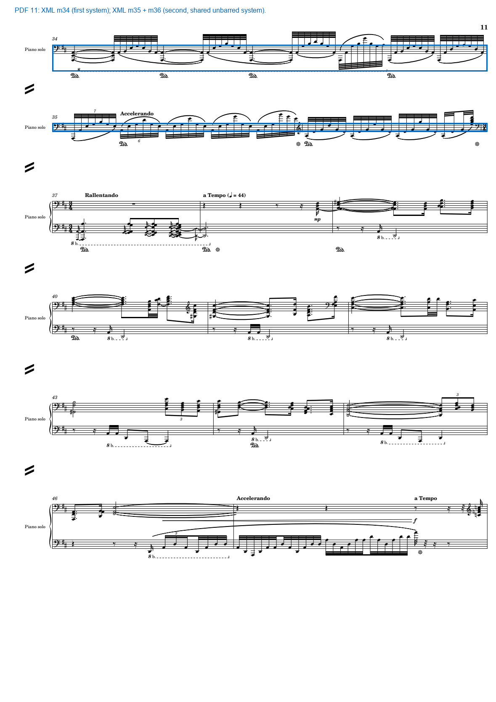

# 拉威尔完整管弦乐MusicXML：接入与音乐分析证据

后续完成并列读法、当前多乐器展示及真实浏览器验收，见[研究版验收报告](ravel-acceptance-20261026.md)。下文保留首次接入时的结果与验收范围。

2026-10-26。MusicXML现作为拉威尔全谱的主要符号来源；原有录音对齐、PDF显示、人工锚点与独立研究文章保留。音乐分析不调用MIDI—PDF音符对应表作为准入条件。

## 1. 输入与版本核查

用户提供的压缩MusicXML为784,297字节，SHA-256为`ee62a04480c56cd9b18b7dbcc00083fcfe26de064e591c0bd6079c98c9513043`。源内登记MuseScore 4.5.2、导出日期2025-05-07，来源链接见解析审计。这是用户取得的转录文件，不因可以解析就升格为杜兰校勘版。

XML含37个分部、535小节、100页及164个系统。37指源文件分部，包含弦乐divisi及分开的铜管／打击乐，不等于37种乐器或37位演奏员。竖琴和钢琴的双谱表在music21中展开后，仍归入原XML分部，声部ID不按谱表机械拆开。

导航PDF同为100页。开头、第10–11小节、第63–64小节的实音样本与先前直接读谱底稿一致；另查看第33页快段、第51页透明织体、第95页重入及第100页收束。此核查支持当前文件的版本接入，不是全曲逐音校勘完成。

首段华彩显示了新来源的实际价值：旧导航把候选33–36段共用第10页框，且漏检第11页前两个单谱表系统。新的独立关系把XML m33定位在第10页，m34及m35–36定位在第11页；第37小节所在系统的XML序号为2。无真实小节线支持的m35–36保留共用系统框，不等宽伪切。旧播放映射未改。



## 2. 统一事件底稿及解析审计

以music21 9.9.2解析全谱，并用其音高、时值、移调、音程与记谱对象解释MusicXML。原XML小节序列、声部号、谱表号、`backup/forward`及有理数时值单独保留，避免依赖每个分部独立累计的全局偏移。

事件表有47,907条记录：23,135条定音音符、649条非定音乐器音符、24,123条休止。每条保留稳定ID、原分部／小节／音符序号、当前乐器引用、声部、谱表、记谱音、XML编码音、实音、移调、起点、时值、连音、连音组、谱号、调号、拍号、符干、符杠、临时记号显示、奏法、八度线和原记谱标记。

三个音高层次必须分开：XML音高数据已经计入八度线的演奏音高，但仍可能是移调乐器的调性记谱；应用显式`transpose`一次得到实音，再逆向恢复八度线下的实际印刷音符。不能再加一次8va。恢复记谱八度时保留D♯等原拼写，不改成等音E♭。

审计发现：

- 607条定音音符和22条非定音音符使用无音头记谱；另251条休止标记不打印，共880条隔离记录。开头多组休止分部含无音头占位音，因此原记录保留，但不进入和声或乐器发声统计。
- 77条装饰音保留原位置与记谱，不分配虚构的演奏时长，其中53条为定音、24条为非定音。
- 56项music21与原XML的时值差异均涉及整小节休止。在华彩和不规则时值小节中，使用XML明确写出的时值，而不是将其统一改成常规拍号长度。
- 4,016项分部累计偏移与统一谱面时轴不同。这是解析时钟差异记录，不是4,016个谱面错误。535个小节各分部的源XML局部总时值一致，公共时轴按明确的源小节时值累计。

原始记录没有删除。22,475条定音事件进入当前记谱实音分析；这不是演奏准确率或已人工核查比例。

## 3. 全谱和声与转位

按所有有效定音事件的开始／结束及小节边界建立前闭后开的区间，得到6,660个和声窗口。每个窗口保存完整音符ID、按分部列出的音符、拼写音集、实际记谱实音低音、音程向量及结构类型。全小节分解和弦音集另存，明确不当作同时发声。

1,824个窗口构成可识别的完整三和弦或七和弦：原位863，第一转位574，第二转位306，第三转位81。其余窗口保留四度、五声或未归约音集，不通过删去不合模板的音来制造和弦。

局部调性使用相邻小节时值分布与music21的Krumhansl–Schmuckler轮廓，保存前三候选及相关系数。相关系数不是正确概率；乐队加倍会影响权重。罗马数字在这些候选调性下分别计算，明确是条件性读法，不把全曲所有和弦都放在D大调中。

### 可复核的推导

| 位置 | 完整记谱事件给出的依据 | 音乐理论判断与范围 |
|---|---|---|
| m1，起点0 | 大提琴D2/G2，低音提琴E1/A1及E–A–D–G活动层 | 音级集合D/E/G/A支持E–A–D–G四度骨架；不是完整E小三和弦，不强写ii |
| m11，起点0 | 全部有效定音事件合为A/C/E，最低E1 | 此时确为Am/E形态。E持续支点上可承载可识别三度和弦；不能反推整个开头都是单一三度和声 |
| m63，起点7/4 | 全部有效定音事件为D/F♯/A，最低A3 | 完整攻击层为D/A，D语境中有I6/4形态；全谱数据支持此前弦乐归约的音集 |
| m64，起点0 | 全体记谱音集A/B/E/G♯，最低A3；弦乐D→E、F♯→G♯ | E大三和弦上层叠合A持续音；不是规范6–5／4–3直接解决。不能只凭上层E大三和弦宣告完成V/V功能 |
| m126，起点0；PDF33页 | 实音E/G♯/B，最低E1；谱面快段起点、6/8、四升号 | E大三和弦及E支点明确。局部E大调假设比机械沿用D大调更有解释力；整段调性仍须连续归约 |
| m535，起点2 | 留存的记谱长音合为D/F♯/A，最低D3 | 末攻击为原位D大三和弦。此前低音和打击乐的声学余响未模拟，不能把最低记谱音D3误当作实际录音此刻已无D1余响 |

每例的所有声部、音符、时值和窗口ID见[完整案例证据](../output/research/ravel-musicxml/selected-case-evidence.json)，全谱变化见[和声台账](../output/research/ravel-musicxml/harmonic-ledger.csv)。以上推导分别限定谱面音集、转位和功能层次，不用和弦识别代替乐句判断。

## 4. 声部关系与配器

XML声部中只有在当前片段为单音且不重叠时，才进入连续声部对比较；同一XML声部内的和弦、divisi和八度加倍攻击另存。不会为了得到四部对位而将每个和弦音自动串成四条旋律。

全谱保存50,006条声部对音程见证、37,000条非静止运动关系、4,514组和弦／分部攻击音程。反向、斜向、同向和平行记录都有原音符ID；平行五八度不是自动作曲错误。这些数量不等于独立对位段落数，当前也不据此认证卡农、赋格或严格对位类别。

第10–11小节圆号的八度加倍、巴松双音的平行六度，可以与先前逐谱窗口互相检查。圆号F4–E4–D4相对巴松B♭2有局部经过性不协和，但E同时属于低音巴松E持续层；不能把局部经过性质扩大成全体织体的“非和弦音”。

535小节均保存各分部的活动／休止、实音音域、攻击、持续音、最低／最高音区职责及记谱奏法上下文。乐器变化引用原XML乐器ID，例如P6在m126的B♭调单簧管与m251的A调单簧管分别应用−2与−3半音，不能只看分部标题“in LA”。

配器研究补充两点：

- **m251／PDF51页**：除长笛、短笛、竖琴、钢琴与拨弦弦乐层外，A调单簧管在起点短暂奏出实音C♯4，随后休止。此前文字未明确列出这一短暂活动；低弦休止及短音／连续流动层的分工仍成立。最高音区不直接等同于旋律主导。
- **m520／PDF95页**：中提琴B3/D4、大提琴B2/D3及低音提琴G1在小节内起点2进入；低音单簧管D2在11/4随后进入。钢琴仍在演奏，因此这里确有独奏与乐队重叠，而不是整齐的“华彩结束—全乐队同时开始”。

[逐音事件表](../output/research/ravel-musicxml/note-events.csv)、[全部乐器活动表](../output/research/ravel-musicxml/instrument-activity.csv)与[声部音程表](../output/research/ravel-musicxml/voice-intervals.csv)提供可筛查底稿。音域是源文件的记谱实音音域，尚未逐项完成专家校勘。

## 5. 曲式与动机

延续原有作品—段落—乐句片段层级，给各单元附上XML小节集合，并加入完整的排练号、速度文字、配器变动和和声窗口证据。页级范围仍是导航与工作边界，不冒充精确曲式分界。

全谱比较五次攻击的上层音程序列与时值比例，保留962组跨小节重复模式及每次出现的音符ID。均匀音阶／重复音弱模式先排除，过度频繁模式另标。上层取样是公开声明的归约，不是假定的原谱独立声部；962组模式不等于962个主题。

当前只登记到1项满足“完整相邻和弦根音属到主关系”规则的候选，位于m432的G/B→C/E。它不能直接被称为终止，更不能称为完满正格终止。数量少说明该窄规则不覆盖大量装饰、分解和弦与重叠织体，并不说明全曲只有一次终止。正式终止仍需节拍、低音、旋律、句末和局部调性共同裁定。

`form.json`保存原有层级、材料身份状态、动机比较、终止候选与边界证据。未将作品预设成固定的奏鸣或三部曲式。

## 6. 播放器与数据接口

刷新拉威尔播放器，谱面技术卡片默认并列显示逐谱研究和当前候选小节的XML证据。旧自动候选仍为勾选后的辅助。XML卡片按现有候选区域激活，**不是已经逐音校准的“此刻和弦”标签**。

新增“完整管弦乐MusicXML”折叠入口，可独立选择全部535小节，查看和声、转位、声部、配器和逐音表。选择小节不跳录音；“查看对应谱页”仅翻页。新建立的华彩区域可在该入口查阅，不强行改写旧播放同步。

接口均读取预计算文件，最小播放环境不安装music21：

- `/api/musicxml?track=ravel-left-hand`：输入指纹、汇总、535小节及版本审计。
- `/api/musicxml-evidence?track=ravel-left-hand&measure_id=xml-m0064`：该小节全部事件与四维证据。
- `/api/musicxml-artifact?track=ravel-left-hand&name=harmony.json`：指纹检查后的完整中间文件，仅允许清单中的文件。

当前快照由`analysis/musicxml/current.json`指定。输入和每份中间文件均有SHA-256；源文件、几何或中间证据变化会使缓存失效并拒绝使用。自动引擎不可用时，这些接口仍可读取。

## 7. 复现与范围

计算环境安装`requirements-analysis.txt`；播放仍只需原最小依赖。新建输出目录重算：

```powershell
python -m backend.musicxml_analysis.pipeline --source "resource/ravel left hand piano concerto/maurice-ravel-piano-concerto-for-the-left-hand.mxl" --output "analysis/musicxml/ravel-new-run"
python scripts/export_musicxml_research.py
```

`--reuse-ingest`可复用指纹检查过的旧解析，重新生成分析；记谱拼写与乐器引用仍从原XML复查。此入口目前为拉威尔适配器，不能只改文件名就宣称支持任意作品。

这里交付的是**全谱可计算、可追溯的第一轮音乐理论分析与若干直接核查的推导**。全曲逐音人工签核、全曲和弦外音裁定、完整和声归约、每个终止及最终曲式结论仍未完成。谱面音符时轴不等于录音逐音同步，记谱时值不等于声学余响。

Python完整套件144项，142项通过、2项跳过；前端33项通过。没有music21的最小播放环境另跑13项XML测试，10项通过、3项处理语义测试因可选依赖缺失跳过，预计算读取和HTTP仍通过。实际应用模块与HTTP的内存DOM联调验证了535项选择、XML华彩谱页、录音不跳转、文章与滚动保留，以及旧曲目兼容。主8765服务的XML、研究、PDF和原音频字节范围接口均通过；字节访问不称为试听。

实际验证范围及测试结果见[验证记录](../analysis/musicxml/validation-20261026.json)。本轮没有真实浏览器实播验收，也没有提交或推送GitHub。

方法依据：[music21音高转换](https://music21.org/music21docs/moduleReference/moduleStreamBase.html)、[MusicXML八度线语义](https://www.w3.org/2021/06/musicxml40/musicxml-reference/elements/octave-shift/)、[music21级数分析](https://music21.org/music21docs/moduleReference/moduleRoman.html)、[调性轮廓方法](https://music21.org/music21docs/moduleReference/moduleAnalysisDiscrete.html)。这些说明计算规则，不作为拉威尔具体和声结论的替代证据。
